

# CineWeave · 实机运行截图 | Running-App Screenshots

**CineWeave（镜织）** —— 源码开放的 AI 短剧工业化生产平台，从小说到成片的全自动流水线：
小说创作/导入 → 故事图谱 → 剧本分集 → 身份资产 → 分镜首帧 → 视频生成 → TTS 配音 → 成片导出。

**CineWeave** — a source-available, industrialized AI short-drama production platform: a fully automated pipeline from novel to finished film (novel writing/import → story graph → episodic scripts → identity assets → storyboard first-frames → video generation → TTS dubbing → final export).

🎬 预告片 Trailer: [Bilibili](https://www.bilibili.com/video/BV1iQV26cE4S) · [YouTube](https://www.youtube.com/watch?v=64apa3maxK0)

---

## 截图 Gallery（实机截图 / Live captures）

### 00 · 宗门主枢纽全景 Sect Hub Full Page（Web · 玄夜场景，含项目大厅卡片视图）

宗门主枢纽完整页截图：上方为十一院司入口全景导航，下方为项目大厅卡片视图（6 个项目含所有者标识与状态标签），底部为项目全局风格设定面板。

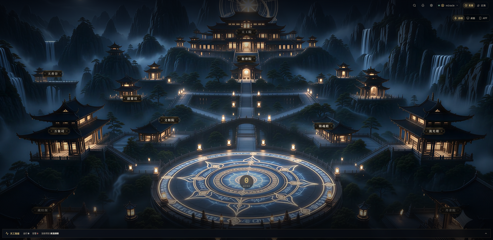

### 00b · 项目大厅卡片视图 Project Hall Cards（6 个项目 · 含所有者与状态标签）

全部 6 个项目以卡片形式展示在项目大厅中，每张卡片包含项目名称、集数、最后更新时间、所有者角色和操作按钮。

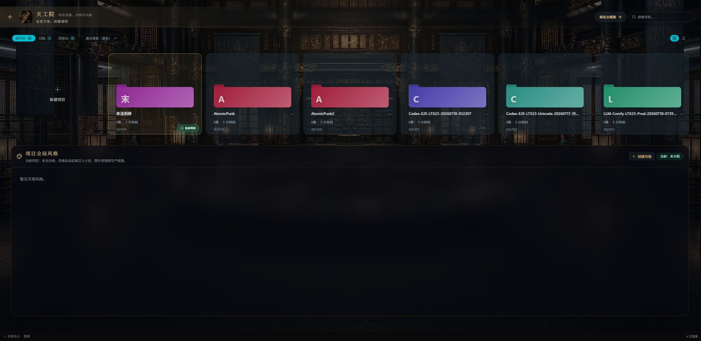

### 01 · 宗门主枢纽 Sect Hub（Web · 玄夜场景 / Xuanye theme）

流水线的全局总控入口。十一院司入口的全景导航：天工院 / 枢密院 / 万象司 / 文枢院 / 叙幕司 / 铸魂殿 / 丹青院 / 流光楼 / 藏经阁 / 天香谷，每个院司对应流水线上的一个生产环节；中央为全局任务法阵，实时显示当前运行中的事务数。顶栏提供搜索、通知、设置与账户菜单，并可切换界面风格（自动 / 桌面 / APP）与场景（玄夜 / 云海）。

### 02 · 入院启令 Login Portal（桌面端 Desktop · Tauri · Local Nexus 本地身份门户）

进入平台的第一道门户。本地优先：身份凭据仅保存在本地、界面不展示凭据；通过验证后选择项目即可进入工作区。支持「登录 / 注册」双标签。

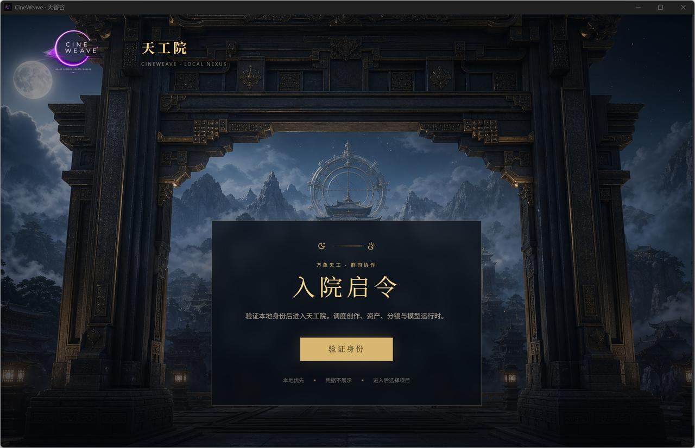

### 03 · 天工院 · 项目大厅 Project Hall

每一个短剧项目在这里创建与管理。支持项目创建、归档、回收站，以及卡片 / 列表双视图切换；任务中心常驻状态栏，实时显示与本地服务的连接状态。

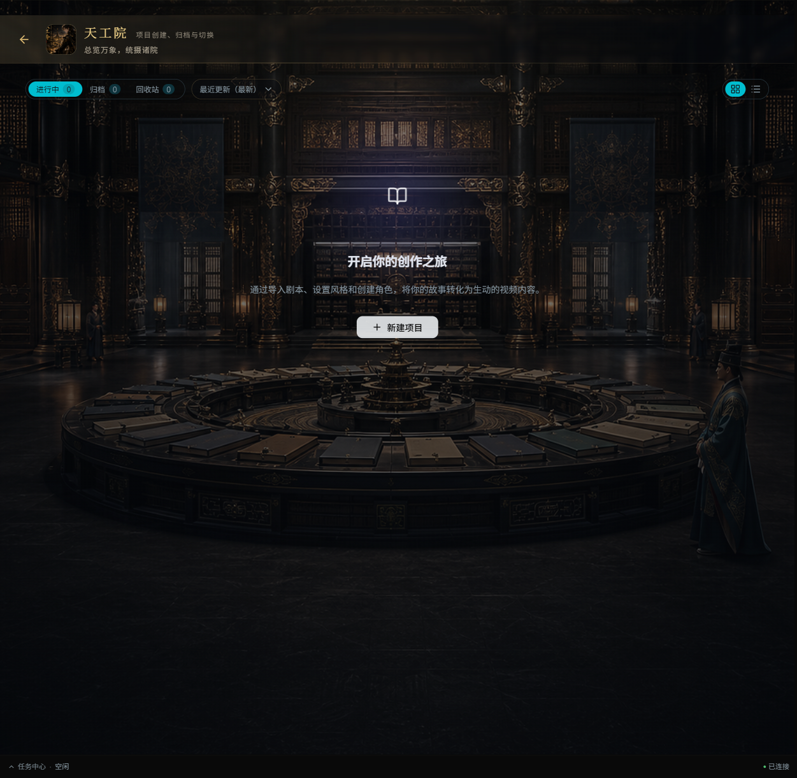

### 04 · 创建项目对话框 Create Project Dialog

流水线的起点。在此填写项目名称、选择项目保存目录，并设定项目全局风格 —— 该风格将作为后续小说、图片、视频制作的统一上下文（机密提示词仅在后端调用，不会出现在客户端）。

### 05 · 天香谷 · 系统设置 Settings · Model Gateway

支撑整条流水线运转的基础设施面板。集中管理模型渠道（Model Gateway）、媒体存储（Media Storage）、本地运行时（Local Runtime）与系统偏好（System Preferences）。

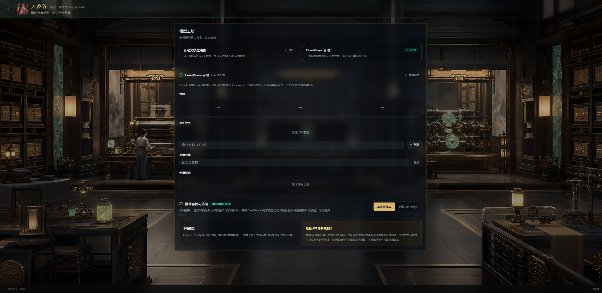

---

## 项目内页巡礼 In-Project Tour（桌面端 · AtomicPunk2 生产现场 / live production project）

以下 11 张截图采集自桌面端（Tauri · Local Nexus）登录后进入真实项目 **AtomicPunk2**（EP1 · Beat 67 渲染阶段）的各院司内页，按**正常生产流程**排序：小说 → 剧本 → 角色 → 分镜 → 视频 → 风格/工作流 → 调度 → 画布 → 目录 → Copilot。All captured inside a real production project on the desktop app, ordered by the actual production pipeline.

### 06 · 文枢院 · 小说工坊 Novel Studio

流水线第一环。支持「一念成篇」（一句话创意，自动演进设定、大纲并写出首章）与「续写章节」（从既有章节延续）双模式；右侧创作卷轴沉淀成篇稿样，成稿可保存为 txt 并一键进入编辑。

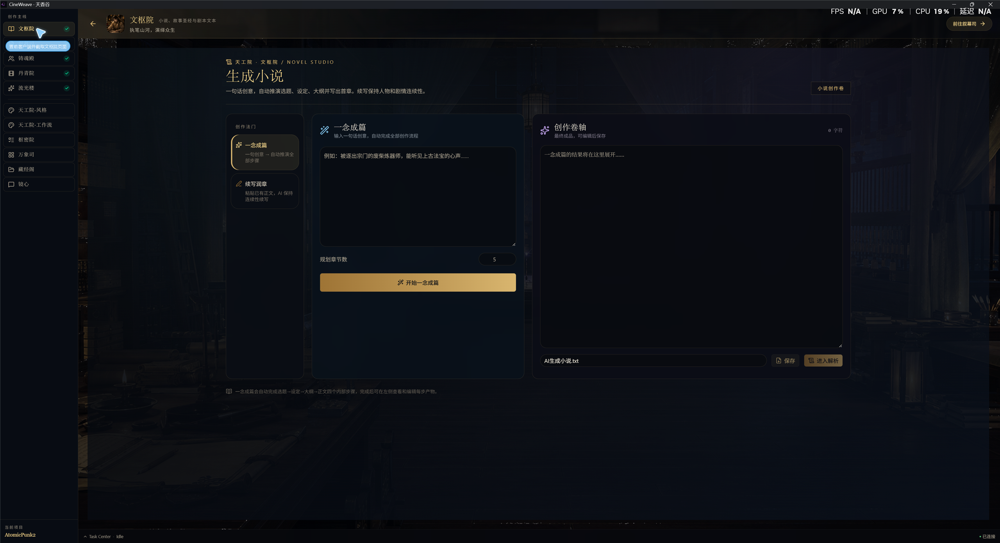

### 07 · 叙幕司 · 剧本分集 Script Studio

小说到剧本的转换枢纽。支持上传小说文件（txt / md / docx，≤10MB）或直接粘贴文本；已建分集列表（EP01/EP02）含字数、集数与进度标签。重新导入将重建故事图谱并触发重算。

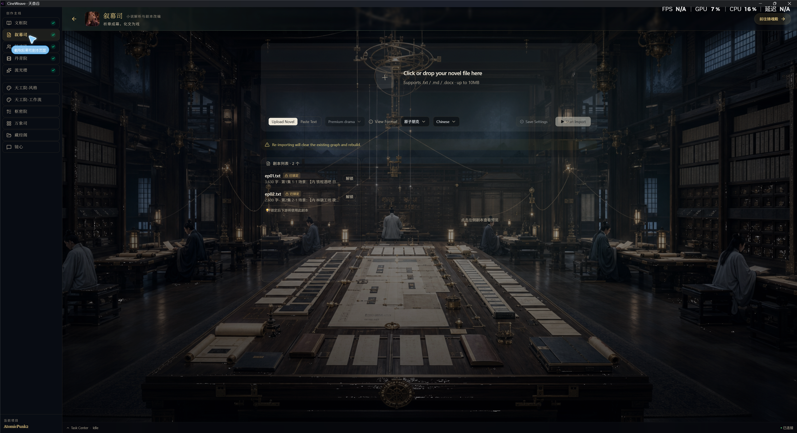

### 08 · 铸魂殿 · 角色身份资产 Characters

角色一致性资产的唯一真源。全项目 4 个角色（林骁 / 老魏 / 三叔赵德 / 赵海平）在此维护定妆照、基础档案（姓名 / 性别 / 年龄段 / 体格 / 描述）与 IndexTTS2 声线配卡——含授权声线 Calling 与 8 条候选声线试听，另为角色自动生成童年 / 青年 / 中年 / 老年年龄变体形象。

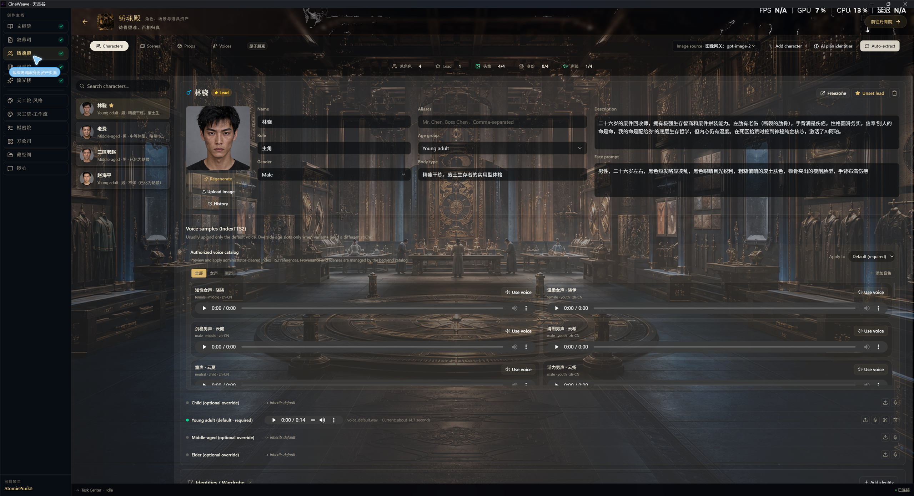

### 09 · 丹青院 · 分镜与首帧生产 Storyboard

分镜工业化现场。按分集展示镜头资产（第一集 10 shots / 第二集 8 shots）与四类资产的就绪状态：角色身份（identities）、场景（scenes）、道具（props），支持 Re-plan identities / scenes / props 单独重排，也可一键重排整集。

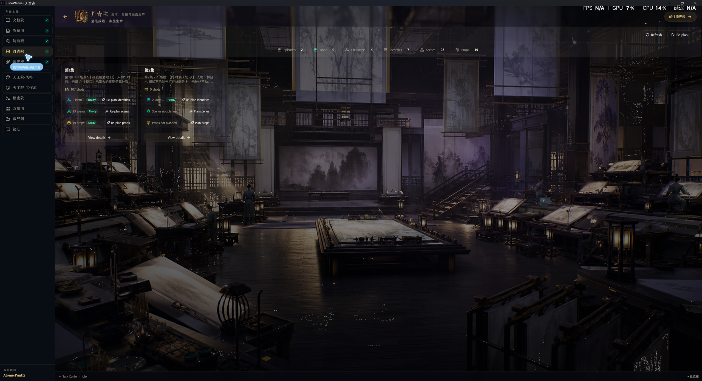

### 10 · 流光楼 · 视频与成片合成 Video Studio

流水线的影像出口。流光制作台提供三类合成：声画描卡（分镜 → 视频，6GM 图生视频抽卡）、分镜合成（镜头串联成段）与成片合成（音频 + 视频合成为片）；按分集（第一集 / 第二集）组织卡片操作。

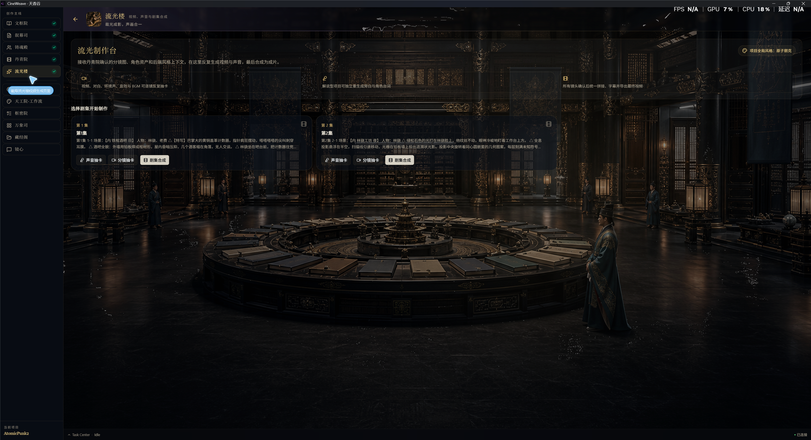

### 11 · 天工院 · 风格设定 Style Studio

项目全局视觉基调的裁定所。内置十余种风格预设（Q版卡漫 / 水墨绘本 / 3D写实国漫 / 写实未来主义 / 90年代写实等），当前展示 Anime Style 预设的人物 / 场景 / 建筑 / 环境四宫格样本，一键应用到整个项目；项目全局风格资产由后端 30M 上下文卷轴管理，各环节生成共享同一视觉基调。

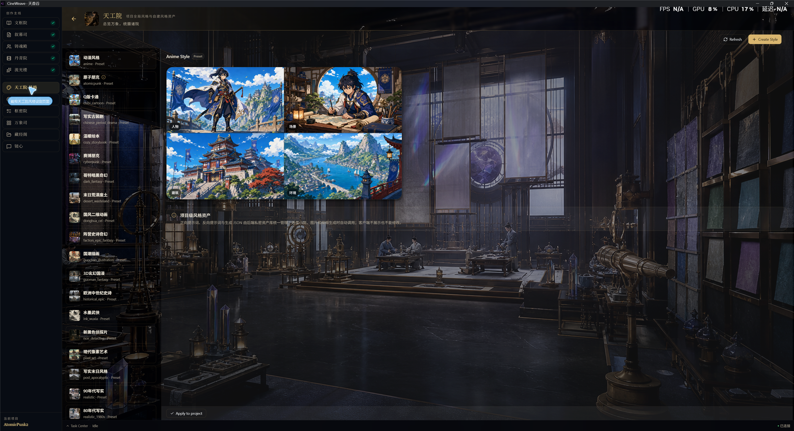

### 12 · 天工院 · 工作流中心 ComfyUI Hub

服务端受控工作流的能力目录。托管 ComfyUI workflow api（WanVideo 图生视频 / FLUX 文生图 / layer diffusion 联合抽卡等，已发现·待执行打标），配合项目待补图片 / 镜头补子（可选）清单，把模型调用收敛为可审计的托管任务。

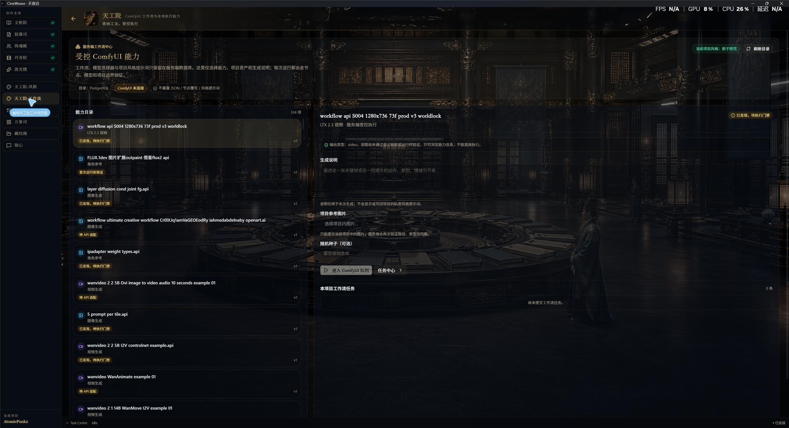

### 13 · 枢密院 · 任务调度 Task Hub

全项目生成任务的调度中枢。按 全部 / 待调度 / 运行中 / 已调度 / 失败 / 已停止 过滤任务列表，支持回队站重排队；当前项目处于空闲态（0/0 tasks）。

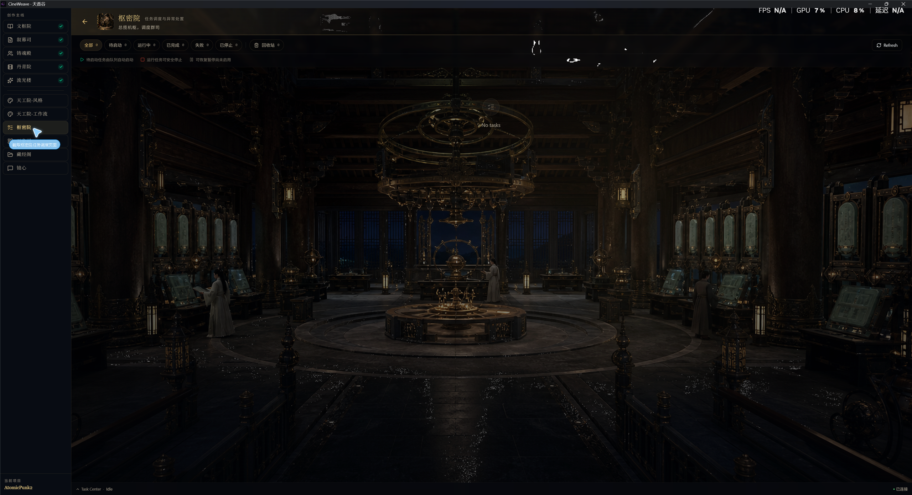

### 14 · 藏经阁 · 项目目录 Library

项目文件的只读总目录：01.小说 → 02.剧本 → 03.人物 → 04.道具 → 05.场景 → 06.分镜 → 07.音频 → 08.视频 → 09.工作流中心 / 09.成片 → 10.画布，可直接在资源管理器打开。每个项目在磁盘上即这棵目录树。

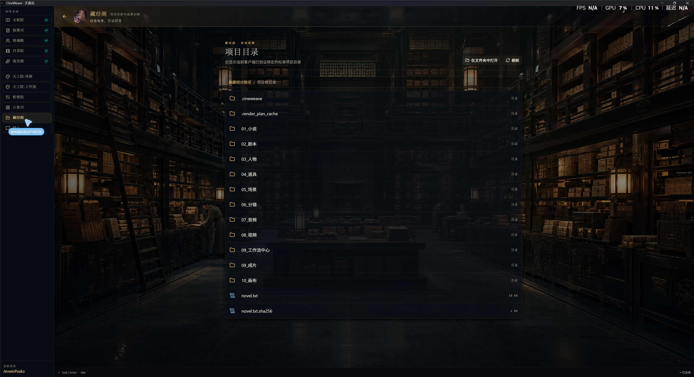

### 15 · 镜心 · AI Copilot

对话式创作协作者。上传剧本后可让镜心推进分集、视觉、音频与成片环节；支持检查故事、推进分集与资产状态查询。

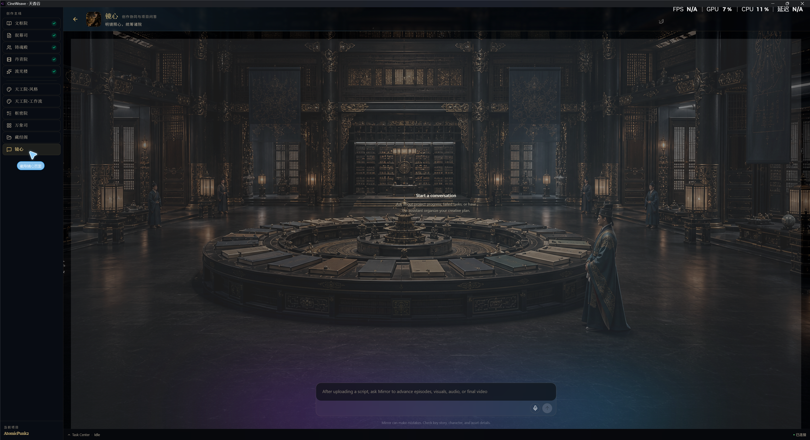

### 16 · 万象司 · 自由创作画布 Free Canvas

跨环节的节点式创作中枢（当前处于 EP1 / Beat 67 渲染阶段）。画布上以节点组织生成链路：Set Current Background / Set Director Combined（显式资产落位）、Sketch from Current Background / Director Combined（草图候选）、Frame from Shot Context（主线成帧）与 Director World 输出合框；右侧模板库提供灵感拆解 / 角色定妆 / 场景概念 / 分镜预演 / 画面生成 / 视频合成 / 多机位九宫格 / 剧情推演四宫格 / 角色设定参考表 / 表情六宫格 / 360°全景图 / 循环批量生成等开盒即用模板，主线资产与项目画布双栏管理。

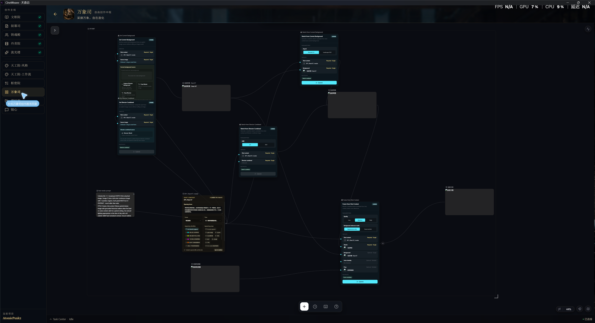

---

## Key Visual（官方主视觉 / official key art）

---

## 说明 Notes

- 以上截图均采集自**本机实机运行**的桌面端（Tauri，Local Nexus）与 Web 端（玄夜主题），未做任何修饰。All screenshots are captured from the **actually running** desktop app (Tauri, Local Nexus) and web app (Xuanye theme) — unedited.
- License: Elastic License 2.0（与主代码库一致 / same as the main codebase）。© ClaymoreLab
