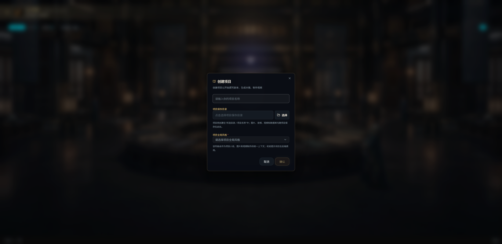

# CineWeave · 实机运行截图 | Running-App Screenshots

**CineWeave（镜织）** —— 源码开放的 AI 短剧工业化生产平台，从小说到成片的全自动流水线：
小说创作/导入 → 故事图谱 → 剧本分集 → 身份资产 → 分镜首帧 → 视频生成 → TTS 配音 → 成片导出。

**CineWeave** — a source-available, industrialized AI short-drama production platform: a fully automated pipeline from novel to finished film (novel writing/import → story graph → episodic scripts → identity assets → storyboard first-frames → video generation → TTS dubbing → final export).

🎬 预告片 Trailer: [Bilibili](https://www.bilibili.com/video/BV1iQV26cE4S) · [YouTube](https://www.youtube.com/watch?v=64apa3maxK0)

---

## 截图 Gallery（实机截图 / Live captures）

### 01 · 宗门主枢纽 Sect Hub（Web · 玄夜场景 / Xuanye theme）

流水线的全局总控入口。十一院司入口的全景导航：天工院 / 枢密院 / 万象司 / 文枢院 / 叙幕司 / 铸魂殿 / 丹青院 / 流光楼 / 藏经阁 / 天香谷，每个院司对应流水线上的一个生产环节；中央为全局任务法阵，实时显示当前运行中的事务数。顶栏提供搜索、通知、设置与账户菜单，并可切换界面风格（自动 / 桌面 / APP）与场景（玄夜 / 云海）。

### 02 · 入院启令 Login Portal（桌面端 Desktop · Tauri · Local Nexus 本地身份门户）

进入平台的第一道门户。本地优先：身份凭据仅保存在本地、界面不展示凭据；通过验证后选择项目即可进入工作区。支持「登录 / 注册」双标签。

### 03 · 天工院 · 项目大厅 Project Hall

每一个短剧项目在这里创建与管理。支持项目创建、归档、回收站，以及卡片 / 列表双视图切换；任务中心常驻状态栏，实时显示与本地服务的连接状态。

### 04 · 创建项目对话框 Create Project Dialog

流水线的起点。在此填写项目名称、选择项目保存目录，并设定项目全局风格 —— 该风格将作为后续小说、图片、视频制作的统一上下文（机密提示词仅在后端调用，不会出现在客户端）。

### 05 · 天香谷 · 系统设置 Settings · Model Gateway

支撑整条流水线运转的基础设施面板。集中管理模型渠道（Model Gateway）、媒体存储（Media Storage）、本地运行时（Local Runtime）与系统偏好（System Preferences）。

---

## Key Visual（官方主视觉 / official key art）

---

## 说明 Notes

- 以上截图均采集自**本机实机运行**的桌面端（Tauri，Local Nexus）与 Web 端（玄夜主题），未做任何修饰。All screenshots are captured from the **actually running** desktop app (Tauri, Local Nexus) and web app (Xuanye theme) — unedited.
- License: Elastic License 2.0（与主代码库一致 / same as the main codebase）。© ClaymoreLab
