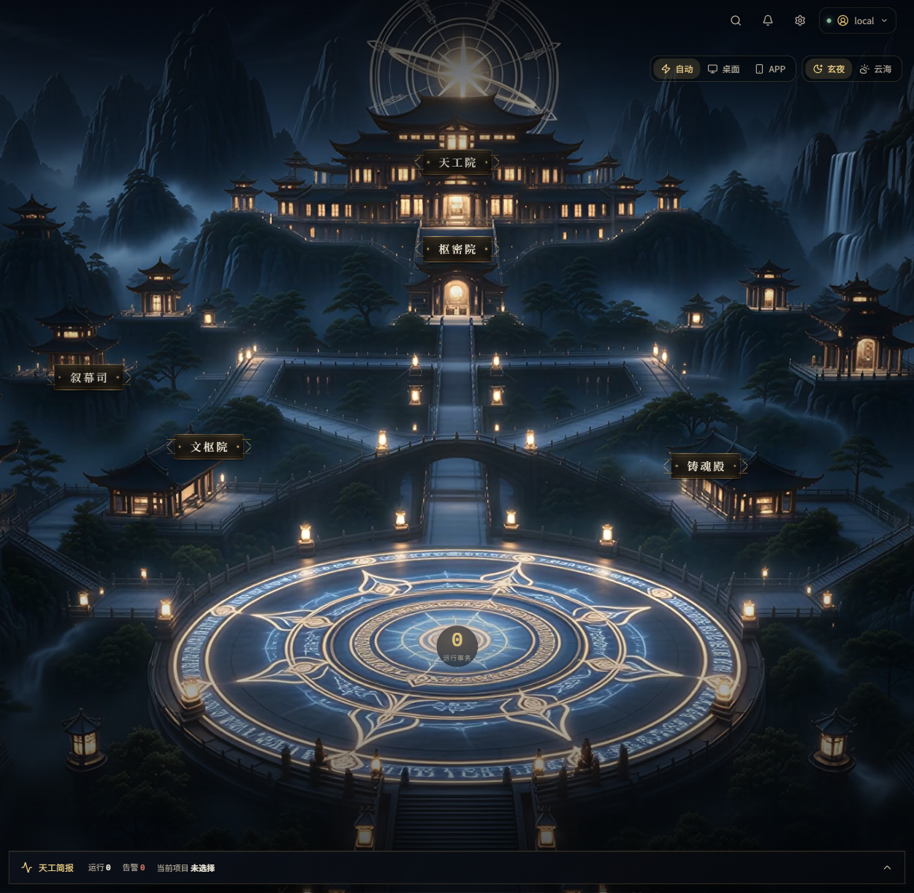

# CineWeave · 实机运行截图 | Running-App Screenshots

**CineWeave（镜织）** — 源码开放的 AI 短剧工业化生产平台：从小说到成片的全自动流水线。
**CineWeave** — an industrialized, source-available AI short-drama production pipeline: from novel to finished film.

🎬 预告片 Trailer: [Bilibili](https://www.bilibili.com/video/BV1iQV26cE4S) · [YouTube](https://www.youtube.com/watch?v=64apa3maxK0)

---

## 截图 Gallery

### 01 · 宗门主枢纽 Sect Hub（Web · 玄夜场景）

十一院司入口：天工院 / 枢密院 / 万象司 / 文枢院 / 叙幕司 / 铸魂殿 / 丹青院 / 流光楼 / 藏经阁 / 天香谷，中央为全局任务法阵。

### 02 · 入院启令 Login Portal（Desktop · Tauri）

本地身份验证门户 —— 本地优先 · 凭据不展示 · 进入后选择项目。

### 03 · 天工院 · 项目大厅 Project Hall

项目创建、归档、回收站与视图切换；任务中心常驻状态栏（已连接）。

---

## Key Visual（官方主视觉 / official key art）

## 说明 Notes

- 以上截图采集自**本机实机运行**的桌面端（Tauri，Local Nexus）与 Web 端（玄夜主题），未做任何修饰。
- Screenshots are captured from the **actually running** desktop (Tauri, Local Nexus) and web app, 玄夜 theme — unedited.
- License: Elastic License 2.0（与主代码库一致 / same as the main codebase）。© ClaymoreLab
